# INATrace frontend (Refine)

The web frontend for [INATrace](https://github.com/INATrace), built with [Refine](https://refine.dev) v5
(used headless), React 19, React Router v7, the Base UI flavour of [shadcn/ui](https://ui.shadcn.com)
and Tailwind CSS v4. It replaces the original Angular frontend and talks to the INATrace Spring backend.

## Getting started

```bash
bun install
bun run dev          # http://localhost:5173, proxies /api to $API_PROXY_TARGET (default http://localhost:8080)
bun run build        # i18n check + typecheck + production build (into dist/)
bun run i18n:check   # translation keys used in src/ vs public/locales/*/common.json (--verbose for gaps)
bun run openapi-ts   # regenerate the API types by hand
bun run test         # Vitest in watch mode (test:run once, test:cov with coverage)
bun run e2e:stack    # Playwright end-to-end against a disposable, seeded backend (Docker); see Testing
bun run e2e          # the same suite against an already running backend
bun run test:ui      # Playwright UI tests with the API mocked (no backend)
```

ESLint can't run at the moment (`typescript-eslint` 8 doesn't accept TypeScript 7).

The `Dockerfile` builds with npm from `package-lock.json` and serves `dist/` with `serve`.

### Configuration

Every variable is optional. `.env.example` documents them all; `.env.development` and `.env.production`
hold the defaults for `dev` and `build` (override them in `*.local` files). Only `VITE_*` variables reach the
app (through `src/lib/env.ts`), and they end up in the built JavaScript, so never put secrets in them.
`API_PROXY_TARGET` and `OPENAPI_INPUT` are read from the shell, not from `.env` files.

| Variable | Purpose |
| --- | --- |
| `API_PROXY_TARGET` | Backend the dev server proxies `/api` to (default `http://localhost:8080`) |
| `VITE_API_URL` | API base URL for a deployed build (default: same origin) |
| `VITE_APP_NAME` | App name shown in the UI and on printed farmer / collector cards (default `INATrace`) |
| `VITE_APP_BASE_URL`, `VITE_QR_CODE_BASE_PATH` | Base of the URLs encoded in QR codes (defaults: this origin, `q-cd`) |
| `VITE_BEYCO_AUTH_URL`, `VITE_BEYCO_CLIENT_ID` | Beyco integration |
| `VITE_PUBLIC_LOG_TOKEN` | Token for public request logging (landing page and QR scans); logging is off without it |
| `VITE_ENVIRONMENT_NAME` | Environment shown on `/app-version` (default: the Vite mode) |
| `VITE_MAP_TILES`, `VITE_MAP_ATTRIBUTION` | Raster map tiles (default: OpenStreetMap; use your own tile server or provider in production, see the [OSM tile policy](https://operations.osmfoundation.org/policies/tiles/)) |
| `VITE_MAP_SATELLITE_TILES`, `VITE_MAP_SATELLITE_ATTRIBUTION` | Satellite tiles for the maps' Map / Satellite switch (maps open on Map). Without them: Mapbox satellite-streets when `VITE_MAPBOX_ACCESS_TOKEN` is set (as Angular), otherwise Esri World Imagery with place names; check the provider's terms for production |
| `VITE_MAPBOX_ACCESS_TOKEN` | Mapbox token for the satellite view (see above) |
| `VITE_GOOGLE_ANALYTICS_ID` | Google Analytics measurement ID (loaded after cookie consent) |
| `VITE_CHAT_APP`, `VITE_ROCKET_CHAT_SERVER` | Live chat: `rocket` loads Rocket.Chat livechat after consent; `intercom` only asks for consent, as in Angular |
| `OPENAPI_INPUT` | Spec for client generation, e.g. `http://localhost:8080/v3/api-docs` (default: `openapi/inatrace-api.json`) |

### API client

Only **types** are generated: `@hey-api/openapi-ts` with the `@hey-api/typescript` plugin writes
`src/client/types.gen.ts` (via `@hey-api/vite-plugin` on every dev start and build). The checked-in spec
`openapi/inatrace-api.json` is a copy of the live backend's `/v3/api-docs`.

All requests go through Refine's [`@refinedev/rest`](https://refine.dev/core/docs/data/packages/rest-data-provider/)
data provider (`src/providers/data.ts`):

- CRUD resources (`useTable`, `useForm`, `useOne`, `useList`, …) map to endpoints in `src/providers/resources.ts`.
- Other operations are listed in `src/lib/endpoints.ts` as typed descriptors (method + URL, typed by the
  generated `*Data` / `*Response` types) and called with `call()` / `useApi()` from `src/lib/http.ts`, which go
  through the provider's `custom` method and Refine's `useCustom`.

## Project structure

| Path | Contents |
| --- | --- |
| `src/App.tsx` | All routes: guest, public, B2C product page, QR redirects, authenticated app, legacy-URL redirects |
| `src/providers/` | Refine providers: data (`data.ts`), resources (`resources.ts`), auth, i18n, notifications |
| `src/lib/` | Endpoint list (`endpoints.ts`), API helpers (`http.ts`, `api.ts`), env, i18n, cookie consent, lazy pages |
| `src/stores/` | zustand stores: selected company, self-onboarding |
| `src/hooks/` | Session / selected company, roles, lookups, table filters |
| `src/pages/<area>/` | Pages; larger forms are folders with a `model` file plus section components |
| `src/components/ui/` | shadcn/ui components (generated with the shadcn CLI) |
| `src/components/refine-ui/` | Refine's shadcn layer (data table, layout, buttons, views) |
| `src/components/app/` | Shared app pieces: page chrome, form fields, upload, maps, guards, onboarding |
| `src/client/types.gen.ts` | Generated API types (don't edit) |
| `openapi/inatrace-api.json` | Checked-in backend OpenAPI spec |
| `public/locales/` | Translations |
| `scripts/i18n/check.ts` | Translation key check |
| `docs/screenshots/` | README screenshots |

## Architecture

How the concerns of the original Angular frontend map onto this codebase:

| Concern | Angular | Here |
| --- | --- | --- |
| API types | `openapi-typescript-angular-generator` | `@hey-api/typescript` → `src/client/types.gen.ts` |
| HTTP | `HttpClient` services | `@refinedev/rest` data provider (`src/providers/data.ts`) + `src/lib/http.ts` |
| Response envelope `{status, data}` | handled per call | unwrapped in the provider's `mapResponse` |
| Error toasts (`TokenInterceptor`), `language` header | HTTP interceptors | ky hooks on the data provider |
| Auth (cookie session) | `AuthService` + guards | `src/providers/auth.ts`, `src/components/app/guards.tsx` |
| Selected company | `SelectedUserCompanyService` | `src/stores/company.ts` (same localStorage key) + `CompanyGate` |
| CRUD lists / forms | hand-written RxJS | Refine hooks → resource table in `src/providers/resources.ts` |
| Tabs (`TabCommunicationService`) | top-nav service | route-driven `PageTabs` |
| `list-editor`, `single-choice`, `attachment-uploader` | shared components | `EntityListField`, `EntitySelectField`, `SearchSelectField`, `UploadField` |
| i18n (`$localize`, locale in the URL) | `@angular/localize` + `assets/locale/*.json` | Refine `i18nProvider` + i18next (`src/providers/i18n.ts`, `src/lib/i18n.ts`) |
| Maps | Google Maps + Mapbox GL | MapLibre + OpenStreetMap tiles (`src/components/app/map-view.tsx`) |

## Translations

The UI follows Refine's [i18n guide](https://refine.dev/core/docs/guides-concepts/i18n/#i18n-provider): an
`i18nProvider` backed by i18next, and `useTranslate()` in components (`t()` from `src/lib/i18n.ts` for text
outside components).

- **Files:** `public/locales/<lng>/common.json` (EN / DE / RW / ES), nested JSON loaded at runtime.
  `en` is the source text and the fallback for keys a language doesn't have yet.
- **Keys:** `<area>.<kind>.<name>`, where area is the page folder (`stock`, `stock.payments`, `userCustomers`,
  `b2c`, …) or `common` for shared text, and kind is `fields`, `titles`, `buttons`, `errors`, `placeholders`,
  `descriptions`, `notifications` or `texts`. Shared buttons and notifications use Refine's top-level
  `buttons.*` / `notifications.*`. Example: `translate("userCustomers.plots.titles.newPlotBoundaries")`.
- **Placeholders** use i18next's syntax: `translate("b2c.texts.farmersFrom", { producer })` for
  `"Farmers from {{producer}}"`.
- **Check:** `bun run i18n:check` (part of `bun run build`) fails on a key used in `src/` that `en/common.json`
  doesn't have; `--verbose` lists the keys each language is missing and unused keys.
- **Language:** a user's profile language applies at login and when they change it in "My profile"; the UI
  switches in place. The language picker in the app header does the same: it switches the UI and saves the
  choice as the user's profile language. Angular's locale-prefixed links (`/de/…`, `/rw/…`, `/es/…`, `/en/…`) still work: they set
  the language and open the same page.
- **Origin:** the de / rw / es text was migrated from the Angular app's locale files. This repo owns the
  translations now.

## UI changes from Angular

Screenshots of the same company account in the original Angular frontend (left) and this one (right). The second
row shows this app in dark mode, which follows the system setting or the theme switch in the header; Angular had
no dark mode.

### Login

A single centred sign-in card with a link to registration. The cookie banner no longer covers the form: it only appears when the deployment configures a tracker.

| Angular | Refine |
| --- | --- |
| 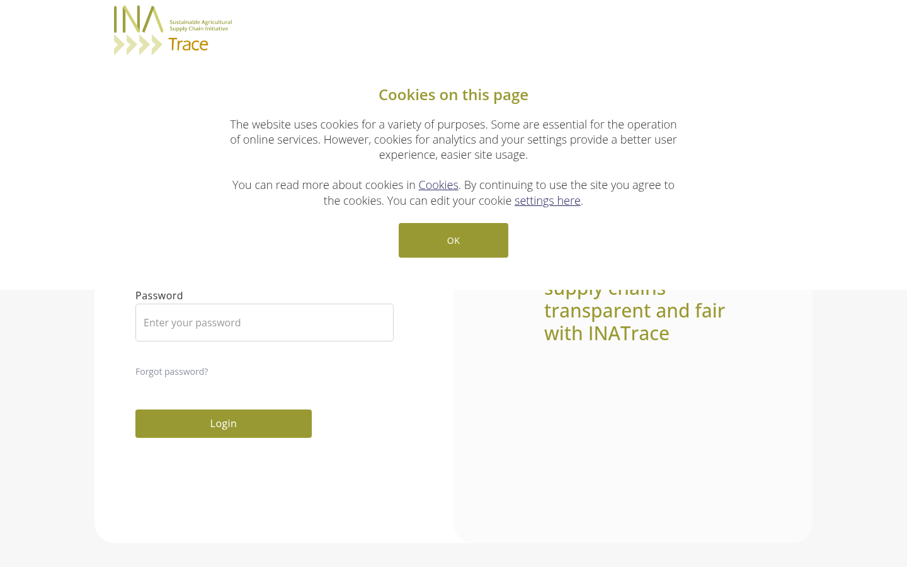 | 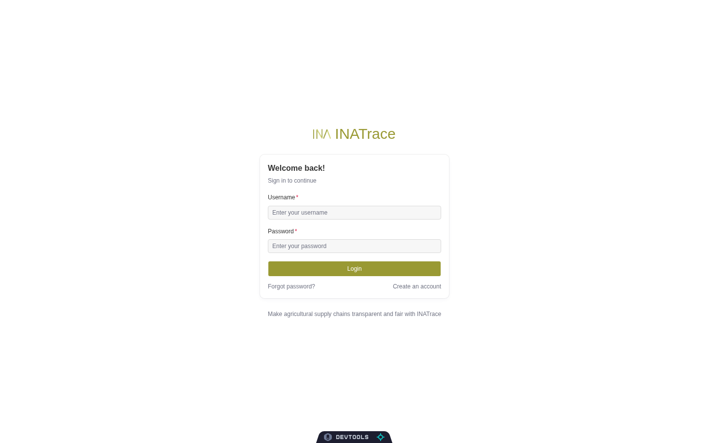 |
| *No dark mode* | 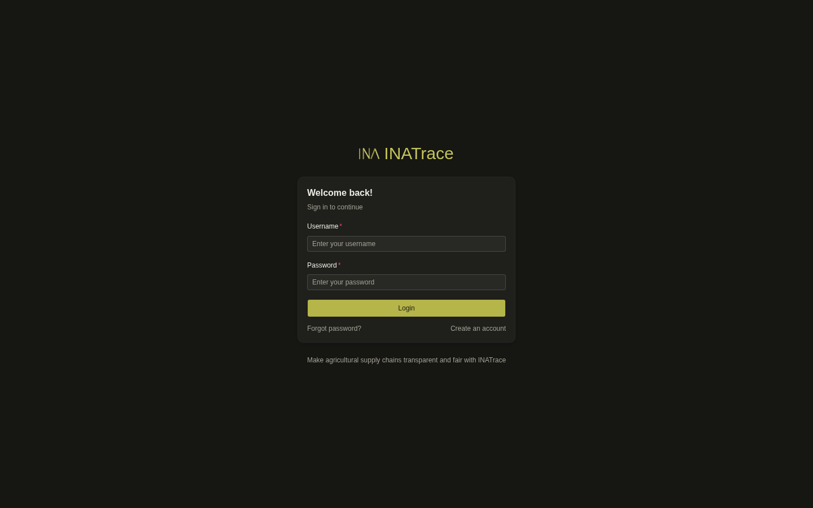 |

### Home

The orange icon rail and the company side panel are replaced by one collapsible sidebar. The header shows the selected company and your role, and has a language picker. The pineapple helper is now a "Need help?" button.

| Angular | Refine |
| --- | --- |
| 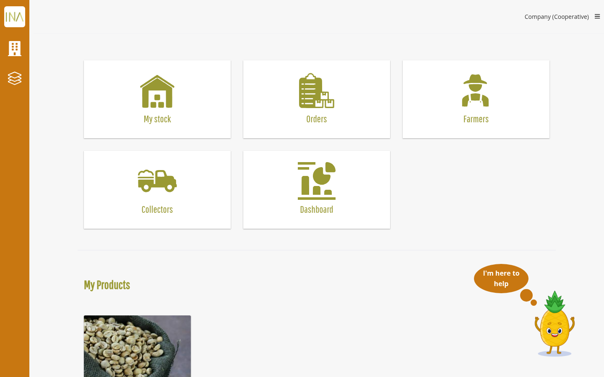 | 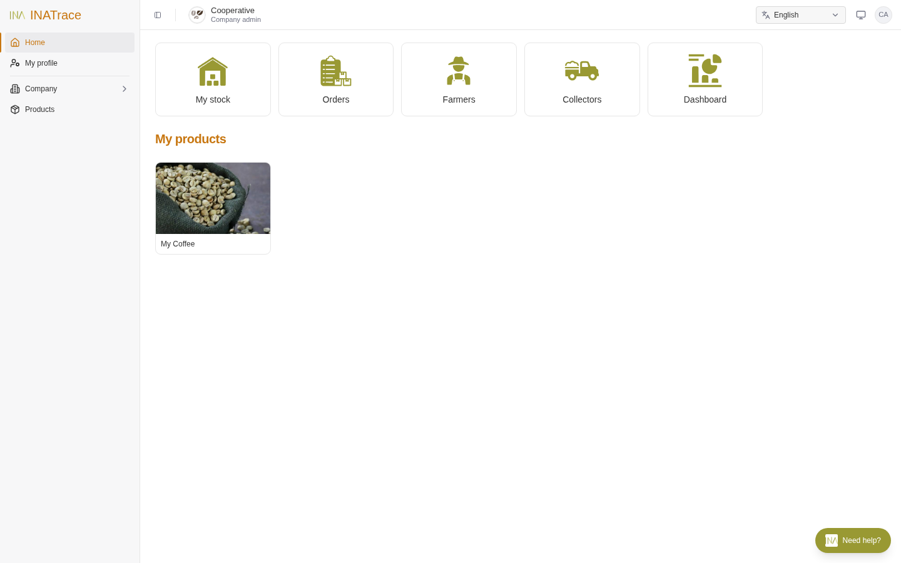 |
| *No dark mode* | 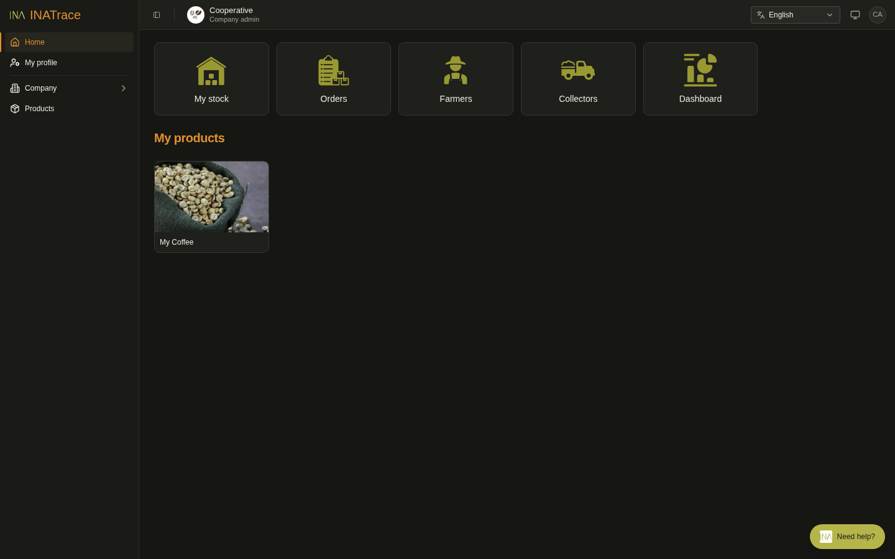 |

### My stock → Deliveries

The stock tabs sit under the page title. Facility, search, date range and filters are on one toolbar, and row actions are in a menu. The table is paginated.

| Angular | Refine |
| --- | --- |
| 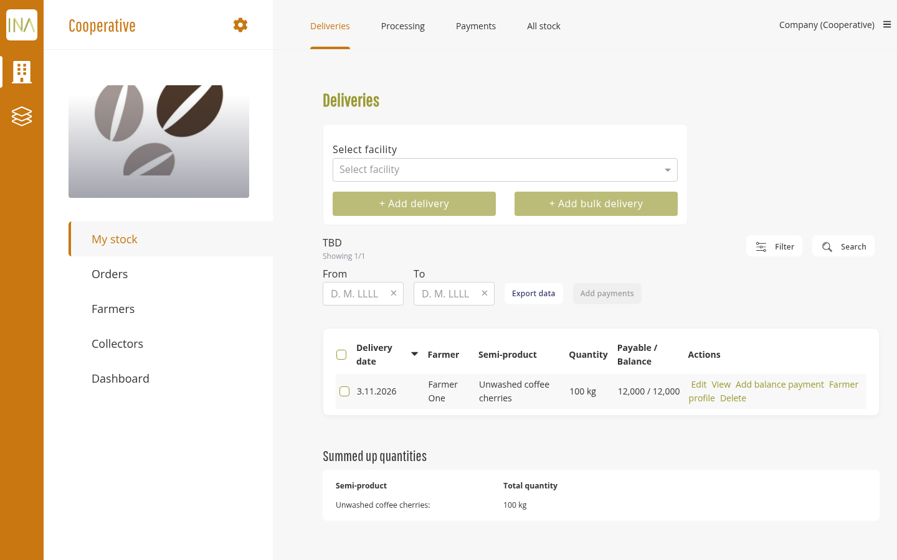 | 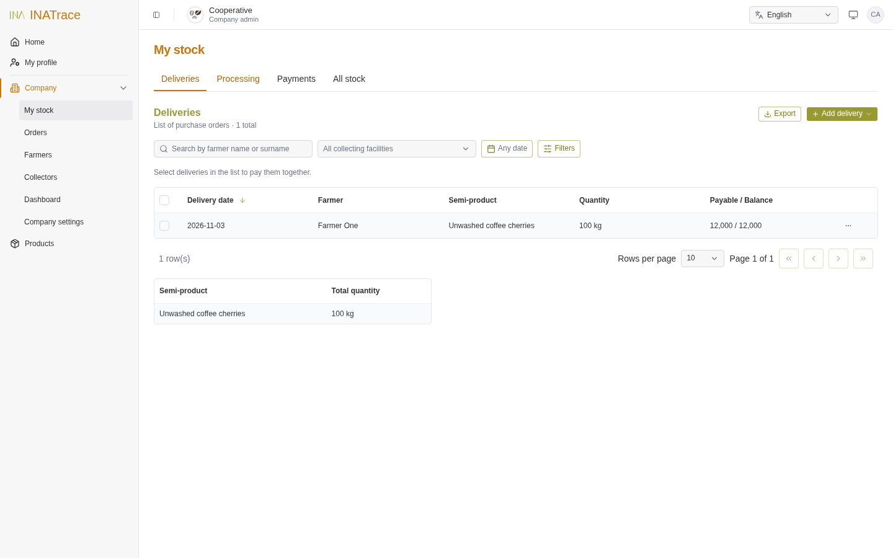 |
| *No dark mode* | 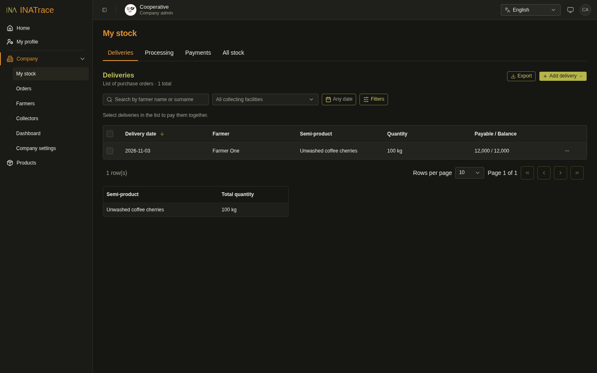 |

### Farmers

Search by a chosen field, a direct "Import farmers" action, and a paginated table. The plots map uses MapLibre with OpenStreetMap tiles and a Map / Satellite switch, in place of Google Maps.

| Angular | Refine |
| --- | --- |
| 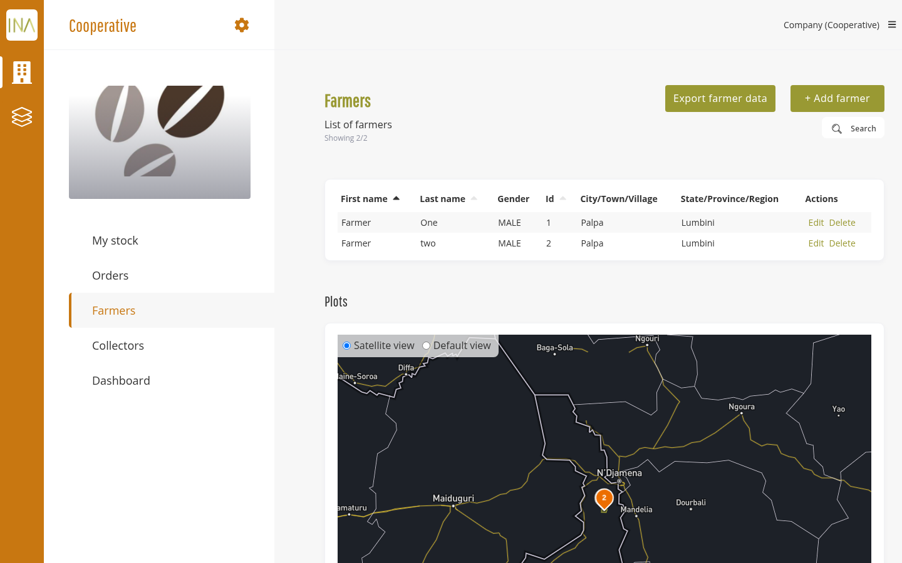 | 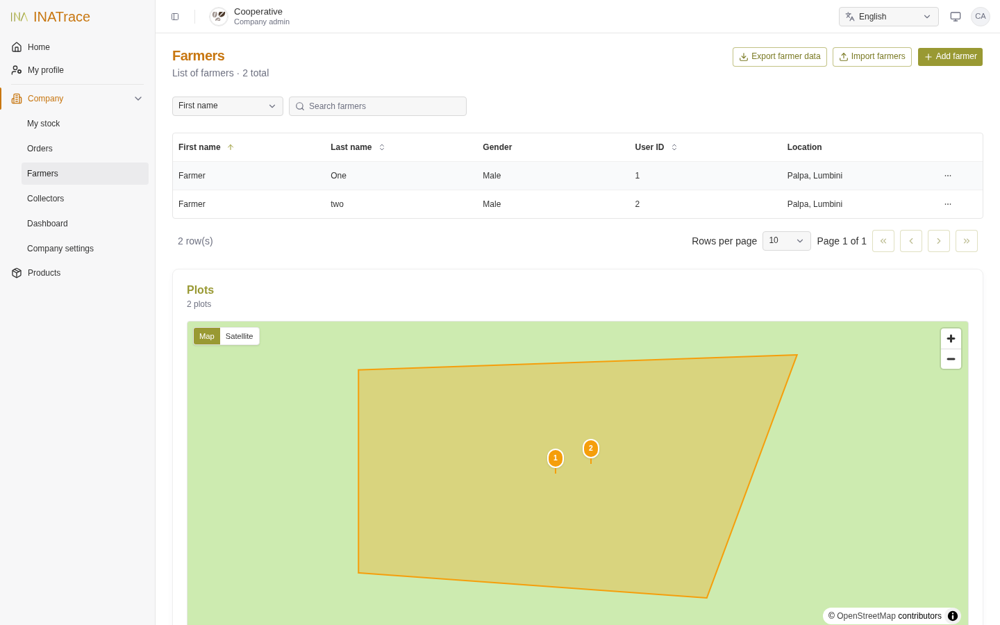 |
| *No dark mode* | 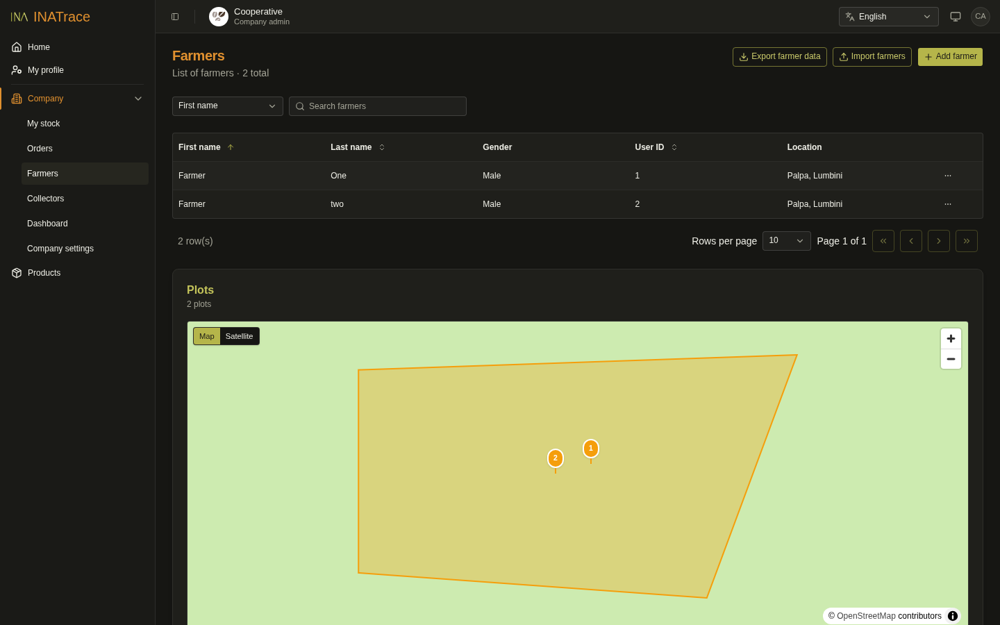 |

### Dashboard

Each chart has its own toolbar: a date range picker, period buttons, facility and semi-product pickers, and an export menu. A table view is one click away, and processing performance shows the output / input ratio as a separate chart.

| Angular | Refine |
| --- | --- |
| 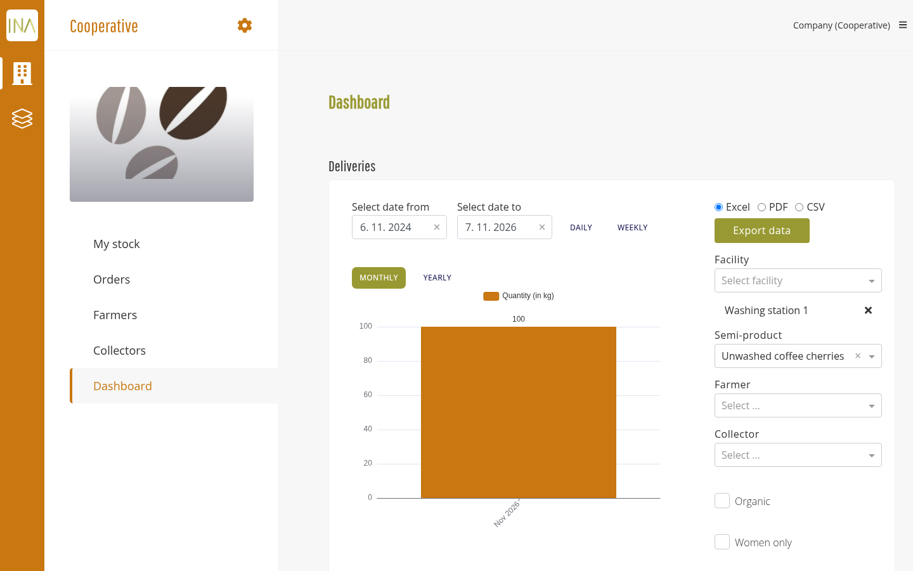 | 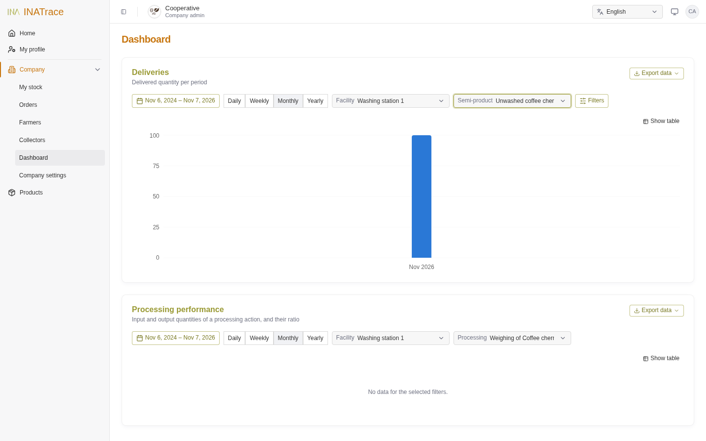 |
| *No dark mode* | 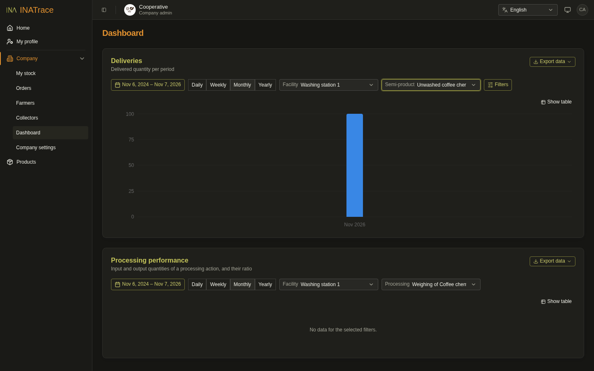 |

## Testing

Three suites, all typechecked by `bun run build`. CI (`.github/workflows/test.yml`) runs all three:

**Vitest** (`bun run test`) for logic and components: tests sit next to the code (`src/**/foo.test.ts`).
Pure modules run in Node; anything that touches the DOM, i18n or the providers runs in jsdom
(`vitest.config.ts` lists the Node ones). `test/` holds the shared harness:

| File | Purpose |
| --- | --- |
| `test/setup.ts` | jest-dom, MSW, real translations without HTTP, Base UI's jsdom gaps, a MapLibre stub, and a reset of the app's module singletons (query cache, cached profile, company store, storage, language) after each test |
| `test/msw.ts` | `server.use(on(ep.x, handler))`: MSW handlers built from `src/lib/endpoints.ts`, typed by the generated response types; `requestsTo(ep.x)` for asserting what was sent. A request no handler answers fails the test |
| `test/render.tsx` | `renderWithRefine(ui, { route, path, profile, companyId })`: the real Refine providers around a page |
| `test/factories.ts` | Profiles per role, countries, company customers (shared with Playwright) |
| `test/tr.ts` | `tr("customers.buttons.addCustomer")` / `trLabel(…)`: find elements by their English text through the i18n key (shared with Playwright) |

**End-to-end** (in `e2e/`): Playwright against the real backend and database, for the critical journeys:
login and logout, route guards for every role, company customers, facilities. Each spec creates its own
uniquely named data and removes it afterwards. Two ways to run it:

- **Disposable seeded backend** (`bun run e2e:stack`, what CI runs). Needs Docker. It starts MySQL (in
  memory), Mailpit and the published backend image (`ghcr.io/agstack/inatrace-backend`, pinned in
  `e2e/stack/compose.yaml`; override with `E2E_BACKEND_IMAGE`) on their own ports (backend :18080), seeds
  them through the API (`e2e/stack/seed.ts`: a system admin, a company, a value chain, and a company admin,
  company user, regional admin and not-yet-activated user), runs the suite against a separate Vite on :5174,
  and removes everything. `bun run e2e:stack --keep` leaves the stack up; then `bun run e2e:stack:test [spec]`
  reruns specs against it and `bun run e2e:stack:down` stops it. To test unreleased backend changes, build
  your checkout instead: `E2E_BACKEND_BUILD=1 bun run e2e:stack` (`../inatrace-backend`, or `BACKEND_DIR=…`).
  When moving to a newer backend image, update `openapi/inatrace-api.json` from the same backend version.
- **An existing backend** (`bun run e2e`), e.g. your dev database behind `bun run dev`:

  ```bash
  E2E_COADMIN_USER=… E2E_COADMIN_PASS=… E2E_COMPANY_ID=… \
  E2E_SYSADMIN_USER=… E2E_SYSADMIN_PASS=… bun run e2e      # system admin optional
  ```

  Roles without an account are skipped. The facilities spec picks the facility type and value chain
  named by `E2E_FACILITY_TYPE` / `E2E_VALUE_CHAIN` (default "Washing station" / "Coffee Value Chain").

An empty INATrace database has no administrator and only administrators can activate users, so the seed
script promotes its first system admin with one SQL statement in the stack's MySQL; everything else goes
through the API.

**UI tests** (`bun run test:ui`, in `test/ui/`): Playwright with every `/api` call mocked, for what a real
backend can't produce on demand: server errors, validation responses, roles there's no account for.
They need no backend and run in CI. The mock (`test/ui/api-mock.ts`) is built from `src/lib/endpoints.ts`
like Vitest's and fails on any request nobody mocked; `test/ui/fixtures.ts` sets the user
(`test.use({ profile })`) and the selected company.

Both Playwright suites share the page objects in `test/pages/`. Playwright starts Vite itself (or reuses
one already on :5173); `E2E_BASE_URL` points it at a running deployment instead. Reports, traces and
saved sessions go to `.playwright/` (`bunx playwright show-report .playwright/report`). First run:
`bunx playwright install chromium`.

## Behaviour changes from Angular

Deliberate differences from the original Angular frontend:

- Maps use MapLibre with OpenStreetMap tiles instead of Google Maps + Mapbox, so no Google / Mapbox keys
  are needed. Satellite imagery comes from `VITE_MAP_SATELLITE_TILES`, Mapbox (`VITE_MAPBOX_ACCESS_TOKEN`) or, by default, Esri World Imagery.
- The language is kept in local storage instead of a URL prefix; prefixed links redirect (see Translations).
- Changing the language switches the UI in place instead of reloading the app.
- Translations use Refine-style keys in `public/locales/<lng>/common.json` instead of Angular's message ids, and
  are maintained here rather than copied from the Angular app. Where Angular had several ids with the same English
  text in one area, they now share one key (and one translation).
- Logging in returns you to the page you asked for (`/login?to=…`), also after a session expires mid-page.
  Angular always went to `/home`: its `/login/<path>` form was never generated and isn't supported here.
- Saving your profile returns to the page you came from, as Angular did; an admin saving a user returns to the
  users list (Angular went to `/home` when no `returnUrl` was given). Back buttons that go back in history fall
  back to `/home` when the page was opened directly.
- Beyco token refresh actually runs (Angular scheduled it but never sent the request).
- The dashboard shows the processing output / input ratio as its own chart (Angular put it on a second y-axis).
- The "Offsetting" payment option was labelled "Cheque" in Angular; it is labelled correctly here.
- `/q/:uuid` opens the label's B2C page (Angular redirected to a `/p/` route that no longer exists).
- The public knowledge blog uses the public endpoint, so it works for visitors who aren't logged in.
- Plot sizes are real hectares (m² / 10 000). Angular divided square metres by 1 000 and labelled the result "ha",
  so its sizes were 10× too large. Plots already saved keep their stored size.
- A single-point plot has one pin: clicking the map again moves it (Angular kept adding points).
- Editing an existing company member only changes the role; Angular also let you swap the user, which then set
  the role of someone who wasn't a member.
- Label fields have no drag-reordering: Angular's reorder mode could never be switched on. Saving keeps the
  saved field order.
- Self-onboarding: Angular opened separate wizard dialogs for the first facility and processing action; here
  the checklist guides you to the regular facility / processing action forms and points at their Save button.
  Each hint can be dismissed (×), which stops that flow.
- The cookie banner only appears when the deployment configures a tracker (Google Analytics or Rocket.Chat);
  Angular showed it even when nothing would load.
- The B2C "Producers" tab skips the "Learn more about…" heading and the producer-organization heading when
  there is nothing under them (Angular always rendered them empty).

## License

[Mozilla Public License 2.0](LICENSE) (MPL-2.0).
